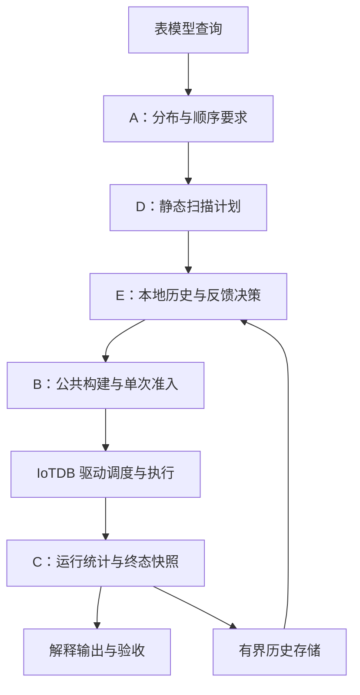

<!--

    Licensed to the Apache Software Foundation (ASF) under one
    or more contributor license agreements.  See the NOTICE file
    distributed with this work for additional information
    regarding copyright ownership.  The ASF licenses this file
    to you under the Apache License, Version 2.0 (the
    "License"); you may not use this file except in compliance
    with the License.  You may obtain a copy of the License at

        http://www.apache.org/licenses/LICENSE-2.0

    Unless required by applicable law or agreed to in writing,
    software distributed under the License is distributed on an
    "AS IS" BASIS, WITHOUT WARRANTIES OR CONDITIONS OF ANY
    KIND, either express or implied.  See the License for the
    specific language governing permissions and limitations
    under the License.

-->

# IoTDB 查询执行并行化完整总体设计

**目的**：为毕业设计《IoTDB 查询执行并行化的设计与实现》说明 A 至 E 的整体设计、阶段职责、运行流程和验收范围。

**摘要**：IoTDB 的表模型查询可以同时处理多个设备或时间范围，但拆分必须保持查询语义与资源约束。五个阶段依次建立属性判定、公共执行构造、运行指标快照、静态分配和反馈调整。本文将五阶段合并为一个完整方案，并解释它们如何共享执行资源与监控数据。实现和验收依据统一采用 2026-11-04 的最终源码与交付证据。

**结论**：A 至 E 已在批准的扫描与聚合范围内完成实现和验收，五阶段形成从语义检查到后续计划调整的完整流程。动态策略根据本地已完成片段的反馈调整后续片段，运行中的工作归属固定。完整设计的成立范围以本文的能力边界和验收范围为准。

未决事项：性能口径采用 3.33 倍还是 2.95 倍、哈希连接是否进入生产规划路径、有色 Petri 网（CPN）形式化是否进入论文正文，均等待 sxing 决定。

## 任务背景

本设计让一条查询利用多个执行分支，同时保证结果完整、顺序正确和资源可回收。研究对象为 Apache IoTDB 2.0.11-SNAPSHOT 的表模型查询，主要优化单条查询内部的扫描执行。

设备数量相同，扫描成本也可能不同。例如，十二台设备中，两台保存了大部分数据。按设备数量平均分配后，某个分支仍可能承担大部分读取工作。提高并行度也会增加算子、交换队列和内存需求，因此系统需要同时处理分配与资源约束。

完成要求包含四个方面：并行与对照返回相同业务结果，所有读取范围恰好归属一次，有序查询保持完整顺序，成功、失败和取消后资源都能释放。性能提升需要独立实验，功能验收只证明这些行为符合设计。

## 核心概念

本设计分别描述读取范围、执行结构和运行记录，避免用同一个数量代表不同对象。

- 扫描源：一个物理扫描节点承担的原始读取任务。
- 工作单元：一次计划中固定归属的设备子集与时间范围。
- 扫描桶：一条本地扫描流水线接收的工作单元集合。
- 流水线：由一个驱动连续执行的一组算子。
- 驱动：提交给 IoTDB 执行调度器的运行对象。
- 片段实例：分布式查询的某个片段在一个 DataNode 上的一次执行。
- 并行度：一个扫描源所选的扫描分支数，沿用 Degree of Parallelism 的缩写 DOP。
- 运行快照：带来源、采样代次和有效性说明的不可变运行统计。
- 查询形态：用于匹配历史反馈的设备、时间条件、表达式、类型、排序和来源位置。

扫描桶与分组聚合的哈希桶承担不同责任。扫描桶分配读取工作，哈希桶把分组键相同的行送到同一个聚合分支。

例如，一个扫描源使用四个扫描桶，根部还有一条合并流水线。扫描并行度为四，实际流水线数为五。一个片段包含多个扫描源时，各源并行度还需要分别记录。

## 总体结构

五阶段按 A、B、C、D、E 的顺序建设，查询运行时则按语义判定、计划选择、资源构造、执行和反馈的顺序衔接。C 提供统一的运行记录，D 保存可核查的静态计划，E 使用 C 的合格历史改进后续计划。

系统始终保留 D 的完整静态方案。E 关闭或反馈不足时，计划选择使用该方案。选定计划随后复用 B 的构建、内存准入和清理过程。

整个方案复用 IoTDB 已有的分布式片段派发和驱动调度器。新增决策决定扫描如何分组，以及采用多少条扫描流水线。驱动就绪、阻塞、唤醒和线程时间片继续由原有调度器处理。

## A：属性驱动的并行判定

### 阶段职责

A 统一回答父节点需要什么输入、子计划实际提供什么，以及系统需要增加什么处理。它为后续并行执行保留可证明的语义边界。

输入要求分为分布与顺序两部分。分布描述所有行是否汇成一个分支，或者相同键的行是否位于同一分支。顺序描述输出按哪些列、方向和空值规则排列。

例如，两个扫描分支都按时间升序时，合并排序可以产生全局时间升序。两个分支各自无序时，系统需要先分别排序，再执行合并排序。

### 属性推导与强制处理

A 根据子计划的实际结构和已有排序证据推导属性，再与父节点要求比较。属性满足时，系统保留现有输入。属性不足时，系统使用收集、排序或合并排序满足要求。

逻辑上的同键共定位与物理哈希路由分别检查。例如，单分支可以保证所有同键行在一起。两个哈希输入即使使用相同键，桶数、键顺序或哈希规则不同，也需要独立检查物理兼容条件。

未知节点采用保守处理。系统保留完整输入，并通过明确的收集或排序建立所需保证。输出字段不足或结构无法满足要求时，规划返回明确错误。

### 并行资格与分组聚合

A 分别维护分布式输出属性和片段内部扫描资格。一个片段对外只有一条输出流，内部仍可以使用多条扫描流水线。

扫描资格只穿过已证明安全的过滤与投影形态。排序、聚合、连接、窗口、全局行数限制等节点继续使用各自的专用判断。有序扫描还需要证明完整自然顺序，随后使用有序合并。

分组聚合保留专用哈希重分区路径。多个源按一致的哈希规则将同键行送入相同聚合桶，片段切分后继续核对源、桶和交换的归属。专用路径拒绝不满足要求的聚合形态，并保留安全执行方案。

例如，源一和源二都含设备 d0。两源中的 d0 必须进入同一聚合桶，才能得到完整分组结果。源数与桶数的验收读取真实身份及拓扑。

### 阶段输出

A 输出满足属性的计划、扫描资格和结构化决策原因。B、D、E 继续使用这些边界，成本反馈只能在已允许的扫描范围内选择计划。

数据来源：[A 属性框架设计](属性驱动并行判定框架设计_20261027.md)及[最终整体实现核查](ABCDE整体实现核查记录_20261104.md)。

## B：统一执行构造与资源生命周期

### 阶段职责

B 将设备扫描、时间分区扫描和有序扫描接入同一套构建与资源管理过程。D 与 E 因而可以共享执行机制，并分别提供静态计划或反馈调整后的计划。

扫描拆分计算先生成不可变描述，计算过程只处理输入与分组。选定计划后，公共构建过程创建子上下文、扫描算子、本地交换和流水线。完整执行树形成后，系统冻结资源记录并执行一次内存准入。

例如，第三条扫描流水线构建失败时，系统终止该片段，并清理前两条及第三条已经建立的资源。清理责任从创建时开始登记。

### 三类扫描

设备模式按设备集合分配工作，无序输出通过收集算子汇合。时间分区模式把设备子集与分区子集组合成工作范围。每条子扫描保留原查询条件，并叠加自己负责的时间范围。

例如，六台设备与三个时间分区形成十八个读取组合。分配后的全部工作必须覆盖这十八个组合，每个组合只出现一次。原查询限定时间二十到八十时，子扫描仍遵守该条件。

有序模式保留逐设备扫描、桶内合并和根部合并。每层都使用已证明的完整排序条件。过滤融合继续复用原表达式执行逻辑，涉及跨行状态的表达式使用保守路径。

例如，两个设备分别输出时间 1、3 与 2、4。合并排序输出 1、2、3、4。重复时间值还需要按查询规定的其他排序键和空值规则比较。

### 交换资源与背压

B 分别记录物理资源对象、内存记账键和实际预留字节。一个共享队列可以具有 source 与 sink 两个包装端点，物理对象只计一次，端点清理责任分别保留。

例如，两个远端通道可以共享一个内存记账键。物理对象数为二，记账键数为一。实际内存按账户累计，验收分别核对三种数量。

真实对象数用于计算诊断分配目标，执行额度沿用兼容基线。名义份额描述分配目标，实际预留来自内存池账户。跨片段共享队列按原子收紧规则发布额度。

当交换内存不足时，生产方等待释放通知。无序收集轮流检查已就绪子流，任何一个子流解除等待都可以唤醒驱动。单块自身超过有效额度时，执行返回明确错误并进入清理。

### 所有权与退出

B 将资源责任分成创建、父子移交、驱动接管与终止四个过程。构建中的资源由登记表负责，驱动接管后沿原执行生命周期关闭。重复终止通过幂等状态处理。

取消覆盖尚未派发、正在构建和已经运行的片段。查询终止还清除共享上下文映射。清理一个端点失败时，系统继续处理其他端点，并保存失败原因。

内存估计覆盖同时存活的扫描、合并算子、交换与保留引用。例如，两个子流同时各保留十 MiB，父级估计需要反映二者共同存活的内存。

数据来源：[B 统一执行设计](B_静态数据并行统一设计_20261031_实施版_复审修订.md)、[无序收集补充设计](B_无序Collect活性补充设计_20261103.md)及[最终整体实现核查](ABCDE整体实现核查记录_20261104.md)。

## C：复用原有监控的运行快照

### 阶段职责

C 将 IoTDB 已有运行统计组织成可核查的快照，供解释输出、执行验收和 E 的反馈选择共同使用。新增部分主要负责身份、字段有效性、冻结和传输一致性。

算子计时、输出行数和数据块数复用原有采集入口。驱动输出取该驱动根部的输出边界，驱动墙钟取本机执行起止记录。实际流水线、扫描工作和资源账户分别关联到快照。

例如，扫描读取十行、过滤后输出四行，驱动输出为四行。扫描的十行仍保留在算子明细中，用于解释过滤工作量。

### 指标含义

C 保留原始量的范围，并仅对有可靠来源的字段计算派生值。跨驱动可加计数按对象身份去重后累计，墙钟分别展示各驱动的值。

例如，两条驱动分别耗时十毫秒和二十毫秒。它们可能同时执行，因此这两个值用于比较分支耗时，查询端到端耗时需要独立测量。

CPU 时间、逐驱动就绪时间、逐驱动阻塞时间、输出字节和内存峰值缺少来源时，字段携带不支持原因。DataNode 全局调度计数只说明节点状态。估计内存、名义份额、实际预留和观测峰值分别保存。

有效的零值仍保留其含义。例如，空扫描桶可以输出零行。资源验收则要求普通受管扫描具备真实对象、账户和正的名义份额，防止全零占位记录通过核查。

### 身份与终态冻结

C 使用查询、片段、实际节点、端点和驱动身份区分运行。计划身份另外保存工作单元、扫描桶、交换边和实际流水线数量。

终态路径先让驱动记录完成统计，再冻结快照，随后释放资源。同一终态重复读取的代次与校验和保持相同。失败路径先保存执行时间端点，再发布失败状态。

例如，一条驱动首次执行时间为 100、末次执行时间为 150 纳秒，墙钟为 50 纳秒。三个值来自同一次端点捕获。不同节点的本地纳秒时间分别解释。

### 传输、合并与反馈

C 复用片段统计 RPC，并按来源分别处理超时和失败。抓取前先登记预期片段集合。收到的响应需要核对来源、版本、身份和校验和。

例如，预期三个片段，只返回两个时，快照保留这两个片段，同时明确标记第三个缺失。整个查询的统计完整性由预期集合判定。

解释分析保留终态统计读取。普通查询的原有上下文可能在查询关闭时清理，因此 E 在清理前复制需要的终态反馈。历史记录的寿命由独立存储管理。

E 使用的第二版协议明确编码扫描归属，第一版按其原规则读取。第二版上线要求 DataNode、协调读取端和验收客户端使用匹配版本，采用整集群同版停机升级。

数据来源：[C 运行指标快照设计](C_运行指标快照设计_20261101.md)、[E 协议与校验设计](E_动态数据并行设计_20261103_第五轮修订.md#协议与校验和)及[最终整体实现核查](ABCDE整体实现核查记录_20261104.md)。

## D：执行前的静态分配

### 阶段职责

D 在执行资源创建前，根据配置、工作范围和存储元数据确定扫描计划。计划选定后，工作归属固定，便于执行、复现和核查。

静态输入包含上下文并行度、设备列表、时间分区、拆分资格、排序证明和可用成本估计。开启数据量估算时，系统先按实际文件数据量压减并行度上限，再选择计划。文件字节是规划估计，适用范围由实际读取的存储元数据决定。

例如，上下文允许八条扫描流水线，数据量估算上限为二，实际计划最多使用二条。C 保存这些输入与最终身份，便于解释计划选择。

### 工作划分与分配算法

D 按扫描模式生成工作单元，并将实际目标限制在输入上限和可用工作数之内。时间分区模式还受设备组数与时间组数的组合约束，实际分支数可能低于输入上限。

例如，六台设备、三个时间分区，输入上限为四时，静态分组可以形成三个时间组和一个设备组，实际生成三个扫描桶。验收读取最终计划中的实际数量。

具有成本信息时，系统按成本从大到小处理工作单元，每次分配给累计成本最小的桶。该算法沿用最长处理时间优先的名称，英文为 Longest Processing Time，缩写为 LPT。成本相同按稳定身份排序，桶负载相同按桶编号选择。

例如，工作成本依次为九、六、三、二，分到两个桶。前两项各占一桶，三进入成本六的桶。两桶都为九后，二进入编号较小的桶，最终成本为十一和九。

缺少可靠成本时，系统采用确定的等量分组并记录原因。时间分区还可以使用已有文件大小加权策略，优先把大分区放入估计负载较小的组。最终计划身份在实际加权分组确定后记录。

### 安全退回与指标复用

D 对单设备、输入上限为一、全局 limit 或 offset、设备溢写、顺序证明不足等条件保留安全路径。串行计划仍包含完整读取工作及原查询条件。时间边界无法精确表达时，系统使用原扫描范围。

原因记录区分正常资格限制、成本缺失、无效元数据和真实规划异常。例如，输入上限为一只表示选择串行。计划构造抛出异常则进入规划异常类别。

D 把所选计划身份写入 C，让运行统计能回答实际执行了哪些工作。D 的生产选择采用配置和静态元数据，历史运行成本由 E 处理。

数据来源：[D 静态数据并行设计](D_静态数据并行设计_20261101.md)及[最终整体实现核查](ABCDE整体实现核查记录_20261104.md)。

## E：面向后续片段的反馈调整

### 阶段职责

E 读取本地已完成片段的合格反馈，调整后续片段的扫描分组或目标并行度。动态开关默认关闭，开关开启后的每个片段固定自己的采集选择。

历史只在产生它的 DataNode 本地使用。相同查询形态的后续执行可以复用历史。同一查询的前序片段只有在后续规划前已经完成、且区域和形态匹配时，才提供可用反馈。

例如，一个片段在 10:00:07 发布终态，10:00:08 开始的后续规划可以读取它。10:00:06 已开始规划的片段使用当时可用的历史。规划准备时冻结可见历史集合。

### 历史资格与成本解释

反馈必须同时满足版本、校验和、来源端点、区域、形态、计划覆盖和驱动归属要求。形态包含真实设备、时间条件、表达式、类型、排序与语义位置，运行期查询编号单独保存。

例如，两次扫描的查询编号不同，但设备与条件相同，可以匹配历史。设备从 d0 改成 d1 后，设备数量虽然相同，形态仍随之改变。

C 提供驱动墙钟、输出行数和数据块数。E 根据实际流水线将驱动关联到源内扫描桶，再把桶成本投影到后续工作范围。独占桶时间与按权重分摊的成本保留不同来源。

例如，一条驱动同时承担两个源，总墙钟为一百毫秒。E 按可验证权重分配这份成本，两源分摊之和保持一百毫秒。单个工作单元的分摊值用于估计后续分配。

缺失、过期、覆盖不完整、计数回退或身份冲突的反馈保留拒绝原因。计数差分仅适用于同一次运行、同一计划及驱动集合。不同查询的完整样本分别用于历史成本。

### 四种决策

E 依次检查安全守卫、可信准入拒绝和成本反馈，保证高优先级原因决定最终动作。每次源选择只定稿一个动作。

保持静态计划用于反馈不足、成本方向不明确或冷却期间。它保留 D 的完整分组，包括已经启用的静态时间分区加权。

重新均衡用于连续两个完整反馈呈现相同倾斜方向，且正成本最大值与最小值之比大于 1.50 的情况。系统为后续片段生成更细的工作单元，再使用 LPT 分配到扫描桶。倾斜方向反转时，策略进入三个检查周期的冷却。

例如，两份合格反馈都显示相同工作范围较重，桶成本分别为九和四，比例为 2.25。比例超过门槛且方向持续，后续片段可以重新均衡。零成本空桶单独处理，倾斜比例需要至少两个正成本。

降低并行度用于可信的同形态内存准入拒绝。前次目标大于一时，后续请求把目标降低一级。目标已经为一而仍被拒绝时，后续采用完整串行方案，并继续执行真实准入。

例如，目标四被拒后，下一请求可以选三，再次拒绝后的后续请求可以选二。每次请求只构建自己的选定计划，拒绝的请求按原内存错误合同结束。

串行退回用于安全守卫要求串行、分组预算或覆盖检查失败等情况。退回计划保留完整设备、时间范围与原查询条件，并记录具体原因。

### 并行度与分组边界

动态目标同时受实际输入上限、工作数和策略目标约束。前次并行度取最近合格冻结反馈的实际桶数，可信准入拒绝优先。重新均衡保留受约束的前次宽度，准入拒绝触发逐级降低。

例如，上下文上限为八，历史实际为四，本次估算将输入压至二。即使策略希望保留四，最终目标也只能为二。该组合已经过真实文件数据量验收。

设备、有序及时间分区模式均复用 D 的守卫。动态分组每源最多包含 1024 个工作单元，重复引用预算最多为 1,048,576。预算检查先于大规模分组物化。

有序模式的工作组数与逐设备扫描数分别计算。例如，一个桶负责 2048 台设备时，执行结构仍需要覆盖这些设备的逐设备扫描。整树内存估计和准入涵盖实际子算子。

时间分区动态计划可以把多个工作单元分到一个桶。例如，两个设备组与 512 个时间组生成 1024 个工作单元。一个桶负责全部单元时，执行构造仍消费全部 1024 个单元。

### 历史与发布开销

历史存储按样本数、键数、字节数和保存时间共同限制资源。默认每键最多 1024 条样本，整库最多 4096 条样本、256 个键、32 MiB 计费数据，保留 30 分钟。单条记录计费上限为 4 MiB。

例如，库内已有 28 MiB，再接收 4 MiB 后达到 32 MiB。继续接收新记录时，存储按接收时间淘汰最早记录，直到满足全部限制。拒绝回执和策略状态也纳入同一套有界管理。

终态路径在统计锁内冻结并复制载荷，锁外验证和写入历史，然后执行原有资源关闭。复制过程具有预算，超界时丢弃动态发布，并记录原因。查询业务结果继续按原执行合同处理。

开关关闭的普通查询跳过新增终态反馈采集。解释分析继续使用自己的统计流程。较大执行计划可能超过反馈保留预算，此时执行范围仍保持完整，后续规划使用可用历史或静态方案。

数据来源：[E 动态数据并行设计](E_动态数据并行设计_20261103_第五轮修订.md)、[E 最终实施进度](E_动态数据并行实施进度_20261104.md)及[最终整体实现核查](ABCDE整体实现核查记录_20261104.md)。

## 一次查询的完整流程

一次查询先证明语义，再选择计划，随后构建执行资源，最后发布统计并释放资源。反馈只影响尚未构建执行资源的后续计划。

1. 分布式规划读取分布和排序要求，建立 A 的属性保证与扫描资格。
2. 片段到达目标 DataNode，规划准备过程固定开关并读取当时可见的本地历史。
3. 每个扫描源建立 D 的实际输入，完成可选数据量估算并得到静态候选。
4. E 按源验证历史与安全条件，选择静态、重新均衡、降低并行度或串行方案。
5. 系统登记最终工作范围，B 创建实际扫描、交换和流水线，并关联源内桶与驱动。
6. 完整树形成后，系统冻结资源与计划记录，执行一次真实内存准入。
7. 准入通过后，IoTDB 原有调度器运行驱动，并按交换背压处理阻塞与唤醒。
8. 终态路径由 C 冻结运行统计，并在满足条件时向 E 发布独立历史副本。
9. 系统关闭端点和驱动，注销内存账户，并释放文件、临时数据与查询上下文。

例如，首次查询使用 D 的四桶静态计划。两次合格完成记录显示稳定倾斜后，后续同形态查询把更细的工作重新分到四桶。先前正在运行的查询继续使用自己的四桶归属。

## 能力边界与扩展方向

2026-11-04 的实现覆盖批准的设备、时间分区、自然有序扫描和专用分组哈希路径。单设备多分区继续采用串行规则，复杂聚合、窗口与状态表达式由既有语义守卫决定执行方式。

本设计的动态调整范围是本地后续片段规划。跨节点历史交换、运行中工作迁移、工作窃取、线程池弹性调整和通用连接哈希重分区分别需要独立设计。生产哈希连接的范围等待 sxing 决定。

单查询并行度是每扫描源的目标，节点总体并发仍受 IoTDB 原有资源管理约束。全片段硬并行度配额和多查询公平分配可以在该接口基础上继续设计。

扩展新节点或新扫描形态时，必须先增加属性与覆盖合同，再接入公共构建、身份记录和对应验收。增加新指标时，必须先确定可靠来源与采集成本，再决定是否进入反馈策略。

## 验收范围

最终核查把源码身份、单元合同、真实业务与资源终态分开验证，并确认最终全量覆盖了关键专项。源码与报告的具体绑定由独立核查记录保存。

最终 DataNode 标准范围包含 840 个类、5327 个唯一测试，失败和错误均为零，跳过 50 项。配置明确排除的 24 个订阅类另列。原 69 项合同和 E 的 249 项专项均纳入该全量范围。

真实业务验证包括单、双 DataNode 的候选与对照重复执行。无序结果比较完整的类型化多重集和 SHA256 摘要，有序查询额外比较全部行序列。读取覆盖同时核对实际节点、片段、源、桶与工作身份。

资源验证包含准入拒绝、取消、构建失败、非法单块和终态清理。动态四种动作、时间加权两档的单桶 1024 扫描、有序 16 设备，以及实际文件估算压减均有对应机器证据。2048 设备子扫描覆盖属于结构测试，规模范围分别保留。

功能正确与性能提升采用独立判据。本设计支持解释执行结构和开展后续性能实验。论文性能数字需要绑定数据集、并行度、节点拓扑、配置和统计方法，再由 sxing 确定引用口径。

数据来源：[ABCDE 整体实现核查记录](ABCDE整体实现核查记录_20261104.md)及[E 最终交付记录](E_动态数据并行实施进度_20261104.md)。
