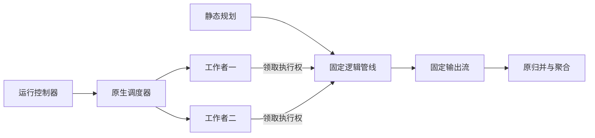

<!--

    Licensed to the Apache Software Foundation (ASF) under one
    or more contributor license agreements.  See the NOTICE file
    distributed with this work for additional information
    regarding copyright ownership.  The ASF licenses this file
    to you under the Apache License, Version 2.0 (the
    "License"); you may not use this file except in compliance
    with the License.  You may obtain a copy of the License at

        http://www.apache.org/licenses/LICENSE-2.0

    Unless required by applicable law or agreed to in writing,
    software distributed under the License is distributed on an
    "AS IS" BASIS, WITHOUT WARRANTIES OR CONDITIONS OF ANY
    KIND, either express or implied.  See the License for the
    specific language governing permissions and limitations
    under the License.

-->

# IoTDB 运行期动态 DOP 设计

**目的**：为查询执行与调度开发者定义同一次查询内调整扫描并发度的协议，并说明代码、测试与服务验收的边界。

**摘要**：查询开始后的负载和阻塞情况可以偏离规划阶段的估计，因此扫描执行需要保留调整工作者数量的能力。本文说明固定扫描状态、原生任务提交、资源准入和终态处理之间的关系。本文同时说明普通 SQL 的查询身份、完整结果和资源证据如何关联。文中的构造示例用于解释判据，实测结果由对应版本的执行回执提供。

**结论**：固定逻辑管线保存扫描和交换状态，工作者使用原生调度器执行。最终 v6 已完成专项、完整回归、双语编译及干净双节点服务验收，同一 SQL 的实际 worker 已形成 1→2→3→2→1。内存回调、有序标记、取消、目标类型切块与原始截止时间等修订均绑定最终发行包；验收范围和上游测试限制见[最终摘要](audit/final-runtime-v6-validation.json)。性能收益仍需独立重复实验。

## 查询执行背景

这项工作在一次查询执行期间调整同时处理数据的工作者数量，并保留查询结果与资源释放规则。负载较大时，查询可以使用更多工作者。查询接近结束或输出持续阻塞时，查询可以减少工作者。

成功的定义包含三项：普通查询返回完整正确的结果，运行记录证明同一次查询发生了实际成员变化，查询结束后实际占用的资源完成释放。规划输出、策略日志和组件测试分别提供局部证据。服务验收把这些证据与同一次普通查询对应起来。

数据来源：[实现步骤与服务验收](运行期动态DOP实现规划草案.md#普通-sql-服务验收)给出可执行的验收范围。

## 术语与执行边界

逻辑管线保存一个固定扫描分片的算子树、工作范围、输出流与依赖。工作者是原生调度器执行的任务，它轮流处理就绪的逻辑管线。执行权表示某个工作者在一个执行量子内独占一条逻辑管线的许可。

运行期并发度采用已激活且尚未完成结算的工作者数量。DOP 的全称是 degree of parallelism，本文用它表示这一数量。瞬时持有执行权的工作者数量还受就绪管线数量限制。

逻辑管线数量固定，工作者数量在许可范围内变化。例如，六条逻辑管线可以由两个工作者轮流处理。增加第三个工作者后，六条管线的设备、时间范围和输出身份保持不变。

片段实例是一个分布式查询片段在具体 DataNode 上的执行实例，英文为 fragment instance，数据来源沿用 FI 标识。前沿预留表示查询启动前为每条固定流保留有界输出容量，后续章节说明它如何支持有序归并。

哈希重分区把同一分组键的记录发送到同一桶，本文沿用代码中的 Hash 路径名称。JMX 的全称是 Java Management Extensions，本文通过它读取运行管理信息。

数据来源：布局由 `RuntimeScanLayout` 表示，执行权由 `RuntimeLaneLease` 表示，工作者由 `RuntimeScanWorker` 表示，片段生命周期由 `RuntimeFragmentLifecycle` 表示，路径均在 [queryengine 执行目录](../../../../iotdb-core/datanode/src/main/java/org/apache/iotdb/db/queryengine/execution/runtime/)及 [planner 目录](../../../../iotdb-core/datanode/src/main/java/org/apache/iotdb/db/queryengine/plan/planner/)。

## 整图执行协议

分布式规划必须在派发前为整张片段图选择一种交换协议，并把同一选择写入全部片段实例。纯数据查询可以选择运行期协议。包含 SchemaRegion 来源的图整体采用原有协议，合并这些来源的 QueryExecutor 也服从这一选择。

例如，一张图包含两个 SchemaRegion 来源和一个 QueryExecutor 根部时，三个实例都使用原有交换。QueryExecutor 具有表模型会话，也保持这一选择。纯数据图包含两个 DataRegion 来源和一个 QueryExecutor 根部时，三个实例可以统一使用运行期交换。

每个实例把协议选择作为独立序列化体的末尾字节传输。值 0 表示原有协议，值 1 表示运行期协议。读取完整实例体时，剩余零字节按原有协议解释，剩余一个字节按显式选择解释，其他长度或取值必须拒绝。

兼容读取的范围限定为一个完整、有界的片段实例体。它支持读取没有末尾字段的历史记录。集群部署必须统一使用同一发行包，跨版本集群必须另行验证。例如，末尾值为 2 或末尾残留两个字节时，接收方必须在构造执行上下文前拒绝。

当实例要求运行期协议，而工作节点关闭运行期开关或会话采用 TREE 时，工作节点必须在创建上下文和交换端点前拒绝。已选择原有协议的图可以在开启运行期开关的节点执行，混合 SchemaRegion 图就属于这一情况。根部结果句柄继续读取实际生产者的整图选择。

数据来源：整图选择位于 `TableDistributedPlanner.configureRuntimeExecution`，字段为 `FragmentInstance.runtimeExecutionEnabled`，编码入口为 `serializeToByteBuffer` 和 `deserializeFrom`。接收验证位于 `FragmentInstanceContext.validateRuntimeExecutionSettings` 与 `FragmentInstanceManager`，结果路由位于 `QueryExecution.usesRuntimeResultExchange`。这些入口位于 [distributed planner 目录](../../../../iotdb-core/datanode/src/main/java/org/apache/iotdb/db/queryengine/plan/relational/planner/distribute/)、[片段计划目录](../../../../iotdb-core/datanode/src/main/java/org/apache/iotdb/db/queryengine/plan/planner/plan/)与[片段执行目录](../../../../iotdb-core/datanode/src/main/java/org/apache/iotdb/db/queryengine/execution/fragment/)。

## 计划资格与原优化器

运行期扫描保留原优化器对顺序、全局行数、设备和算子语义的否决。只有满足既有扫描合法性证明，并完成固定图资源准入的来源，才能建立运行组。谓词下推、投影下推和局部有序构造继续决定实际算子形态。

Hash 路径的批准只恢复透明、无序原始扫描被分布交换统一关闭的并行资格。批准检查沿着透明过滤和投影向下遍历。遇到依赖相邻行顺序的表达式时，检查必须停止，并保留扫描的并行否决位。

构造示例说明这一限制。按顺序读取的数值为 10、13、18 时，相邻差值为 3、5。若处理顺序改成 13、10、18，差值变为负 3、8。因此，包含相邻差值计算的投影或过滤必须服从原顺序要求。

全局下推行数限制、偏移、设备条目溢写和单设备等条件继续参与资格筛选。例如，一个查询的扫描已携带全局行数限制时，Hash 批准集合必须排除该来源。最终串行计划按串行路径验收，运行期路径的覆盖需要真实运行组证据。

数据来源：资格批准位于 [LocalExecutionPlanner.java](../../../../iotdb-core/datanode/src/main/java/org/apache/iotdb/db/queryengine/plan/planner/LocalExecutionPlanner.java) 的 `collectHashRuntimeApprovals`，透明性检查使用 `isTransparentRuntimeHashWrapper`。批准集合继续与可支付扫描集合取交集。顺序敏感表达式使用 `DIFF` 判定，扫描原有 `allowParallelScan` 位保持原义。顺序敏感表达式检查已包含在[修复版专项范围](运行期动态DOP实现规划草案.md#专项与全量验证)中。

## 自然有序扫描的规划标记

自然有序扫描通过明确的排序节点把要求传给本地管线构造。按设备键再按时间读取时，串行扫描可以满足全局顺序。多个本地扫描分支通过有序归并保留这一要求。

分布式规划在每个符合条件的数据来源上保留排序节点，最终排序消除规则同样保留该节点。本地规划读取排序字段并构造单设备扫描和两级归并，工作者数量继续由运行组决定。该处理沿用既有节点的序列化格式。

资格检查只接受原始设备扫描、至少两个内存设备条目，以及可独立执行的设备范围。排序键允许设备标签或属性前缀，并以时间键结束。时间方向必须与扫描方向一致。全局下推分页、设备条目溢写和专用扫描类型分别保留其执行路径。

例如，两个来源各持有四个设备时，两个来源必须分别保留排序节点。每个来源把四个单设备有序流分配给固定管线，再归并管线输出。根部的跨来源归并继续接收两个已排序来源。

当并发度或资源预算只允许串行执行时，本地规划按实际设备键重新证明拼接顺序。证明使用 SQL 的排序比较器，包括方向和空值规则。只有相邻设备键严格递增，且时间方向匹配时，本地规划才能直接构造串行扫描并省去排序。

例如，设备键依次为 a、b、c，且时间方向一致时，按设备拼接满足设备键加时间顺序。两个设备具有相同排序前缀时，前一设备的时间可能大于后一设备的时间，因此该证明必须拒绝。只有时间键的多个设备也保留真正的排序或归并处理。

有序并行开关关闭时，规划继续执行冗余排序消除。相邻差值计算的扫描否决独立生效，资格检查从显式排序要求取得证明。普通查询覆盖和串行排序代价由 v4 的计划、结果与回归回执验证。

数据来源：生产资格和串行证明位于 `OrderedParallelScanEligibility.canUseLocalMergeTree` 与 `canUseSerialConcatenation`。排序节点保留位于 `TableDistributedPlanGenerator` 和 `SortElimination`，本地构造位于 `DataNodeTableOperatorGenerator`。这些文件位于 [planner 目录](../../../../iotdb-core/datanode/src/main/java/org/apache/iotdb/db/queryengine/plan/planner/)与[关系规划目录](../../../../iotdb-core/datanode/src/main/java/org/apache/iotdb/db/queryengine/plan/relational/planner/)。

## 固定布局与初始并发度

静态规划分别确定逻辑布局和初始工作者数量，运行控制只改变后者。逻辑布局包含设备与时间分片、桶、原始管线、工作单元和输出归属。初始工作者数量可以采用静态估计与有效历史提示，固定布局同时受内存和配置上限约束。

运行模式由整图协议选择和节点配置共同约束，默认配置沿用静态执行路径。规划器在构造阶段可以采用有效历史分组，查询开始后保留该分组及其身份。

例如，布局容纳八条管线，而静态估计给出一个初始工作者时，运行组可以从一个工作者开始。若初始值已经等于布局上限，查询仍可正常执行，但服务用例必须另行选择具有升宽空间的输入。

固定状态降低了调整期间的语义变化。工作者交还执行权时，算子和未消费输出继续属于原逻辑管线。工作者自然退役后，其他工作者仍可领取该管线，原逻辑驱动到达结束位置时才产生输出结束通知。

下图表示固定管线与可变工作者之间的关系，工作者数量仅为构造示意。



数据来源：[ScanParallelPlanner.java](../../../../iotdb-core/datanode/src/main/java/org/apache/iotdb/db/queryengine/plan/planner/ScanParallelPlanner.java) 构造固定布局，[DynamicParallelPlanningService.java](../../../../iotdb-core/datanode/src/main/java/org/apache/iotdb/db/queryengine/plan/planner/DynamicParallelPlanningService.java) 选择初始数量。布局描述及依赖绑定由 `RuntimeScanGroupDescriptor` 和 `LocalExecutionPlanContext` 保存。运行期开关为 `enable_runtime_scan_parallelism`，默认值为 `false`。

## 原生调度与成员调整

原生调度器提交直接执行任务和运行工作者，逻辑扫描驱动由运行组持有。根部输出、归并以及其他直接执行任务继续使用原生任务生命周期。逻辑扫描驱动通过工作者调用原执行入口，执行组对每条管线提供独占领取。

升宽采用先预留、后登记、再整批激活的顺序。新增任务继承原查询的用户、绝对截止时间和存活代次。整批登记成功后，调度器才开放执行许可。

用户 CPU 与增量内存配额使用共享账本。例如，同一用户的 CPU 限额为四份，已有三个工作者占用额度时，另一个组申请两份必须被拒绝。拒绝后的候选任务分别完成停止、映射移除和配额结算，已激活成员继续保有原额度。

降宽采用正常退役协议。运行组停止目标成员的新执行量子，并等待已有量子退出。只有工作者停止、原生任务移除和配额归还都得到确认后，调整结果才记录为已应用。

正常退役保留逻辑驱动与交换连接。例如，一个组从三个工作者降到两个时，退役成员交还正在持有的执行权。剩余成员继续处理同一组工作，片段的终止处理由独立的终态协议负责。

数据来源：[DriverScheduler.java](../../../../iotdb-core/datanode/src/main/java/org/apache/iotdb/db/queryengine/execution/schedule/DriverScheduler.java) 提供 `prepareRuntimeDrivers` 与 `activateRuntimeBatch`。增量准入和退役入口分别为 `prepareRuntimeGrowth` 与 `retireRuntimeWorker`。任务登记保存执行停止、映射移除和配额结算回执，用户共享账本位于 [ThrottleQuotaLimit.java](../../../../iotdb-core/datanode/src/main/java/org/apache/iotdb/db/storageengine/rescon/quotas/ThrottleQuotaLimit.java)。

## 控制策略与扫描进度

控制器依据真实运行组状态决定保持、升宽或降宽，并由生命周期对象执行调整。每个片段的采样调用串行运行，一次采样至多发起一个调整。调整进行期间，后续采样保留现有工作者数量。

策略采用连续压力窗口和冷却时间抑制反复调整。源码配置的采样周期与最小窗口均为 100 毫秒，连续压力要求为两个窗口。调整后的冷却时间为 500 毫秒，超过两秒的样本进入过期分支。

构造示例中，两个连续窗口都有就绪积压，并且设备完成数持续增加，策略可以请求把两个工作者增加到三个。若请求在第 250 毫秒发出，下一次常规压力调整必须等到第 750 毫秒或之后。成员调整仍在进行时，生命周期对象继续阻止重入。

未完成管线收缩与持续输出背压可以触发降宽。例如，四个工作者只剩两条未完成管线时，策略分次减少工作者，每次最多减少一个。生产采样中的资源上限采用固定逻辑管线数，用户配额通过实际增量准入约束新增任务。

数据来源：`RuntimeDopPolicy` 保存窗口、冷却与压力判据，`RuntimeDopController` 负责定时采样，`RuntimeFragmentLifecycle` 负责执行请求，均位于 [runtime 目录](../../../../iotdb-core/datanode/src/main/java/org/apache/iotdb/db/queryengine/execution/runtime/)。工作与活动的取值按[剩余工作与扫描活动](#剩余工作与扫描活动)定义。

## 剩余工作与扫描活动

设备完成数用于判断剩余工作，扫描算子输出行数用于描述已经输出的数据规模。二者单位不同，必须分别解释。

设备完成数按固定扫描分配累计。自然扫描结束和确定裁剪都能完成一个分配，提前关闭保留真实完成值。例如，总数为十二，已完成五个，其中两个通过裁剪完成，再完成两个后，完成总数为七。若查询随后取消，完成值仍为七。

长设备可以连续产生数据，同时保持设备完成数不变。例如，两次采样之间设备完成数均为零，而扫描输出从一千行增加到两千行，表示扫描产生了一千行输出。剩余工作仍按尚未完成的设备分配计算。 已有输出计数用于原生统计与验收；额外的量子扫描活动发布候选没有合入，生产控制继续使用已接线的设备进度及就绪、阻塞和容量观测。

生产策略继续用设备完成增量判断工作推进，并用设备总量判断接近结束。扫描行数没有由该计数提供的总量。例如，十二个设备完成七个后，剩余工作为五个设备。累计扫描输出达到八千行时，剩余量仍为五个设备。

高输出诊断查询的实际保持原因以输出背压和最少工作者分支为主。已激活人数为一时，该分支保持一人。低输出、完整扫描的诊断查询已经产生实际升降宽，因此增加独立活动计数的候选保留在隔离暂存中。

数据来源：设备完成来自 `RuntimeScanProgress`，生产策略位于 `RuntimeDopPolicy`。扫描输出已有计数位于 `OperatorContext.getOutputRows`，独立活动候选保持未合入。高输出诊断的终态载荷位于执行记录根目录下 `runtime-sql-acceptance-v3/R1/primary/candidate/r001/statistics/` 和 `trig-backup/candidate/r001/statistics/`。背压下最少工作者分支使用 `MINIMUM_WORKERS`，诊断保留在 `controllerDiagnostics`。

## 有序归并与前沿预留

固定流的前沿容量在启动前完成真实内存预留，因此少量工作者也能为全部排序输入提供首批数据。每条流持有独立额度。工作者在某条流输出阻塞时，仍可轮转其他就绪流。

例如，三个固定流各有一 KiB 的前沿额度，运行组需要先预留三 KiB。第一条流填满自身额度后，工作者转而处理第二条流。第二条流产生较小首值，第三条流随后确认空流，原有归并器就能继续判断输出顺序。

前沿额度属于固定逻辑图，工作者新增资源使用单独预留。消费输出归还内部额度，整组关闭才归还池中的物理预留。归并器仍持有的输入头部由算子基础预算覆盖。

例如，一个输出块被消费者取走后，该流的前沿额度重新可用，但归并器仍可能持有该块的头部。基础算子预留与前沿预留分别覆盖这两段存活时间。资源核查必须按实际账户身份去重，避免把同一物理预留在多个包装对象中重复相加。

数据来源：[RuntimeFrontierReservation.java](../../../../iotdb-core/datanode/src/main/java/org/apache/iotdb/db/queryengine/execution/runtime/RuntimeFrontierReservation.java)、[SharedTsBlockQueue.java](../../../../iotdb-core/datanode/src/main/java/org/apache/iotdb/db/queryengine/execution/exchange/SharedTsBlockQueue.java) 与 [LocalScanPipelineBuilder.java](../../../../iotdb-core/datanode/src/main/java/org/apache/iotdb/db/queryengine/plan/planner/LocalScanPipelineBuilder.java) 共同实现预付前沿。固定图基础估计由 planner 的内存估计入口负责。

## 远端交换与有界编解码

选择运行期协议的片段图为每个输入和输出端点预付有界数据块容量，远端获取和解码借用该容量。输入端保留一次组装和一个正在处理的响应。输出端在发布前压实数据块，并核查编码和驻留大小。

源端在分配解码数组前校验真实类型、行数、列数和长度。支持的编码包括具体基础列、二进制值列和一层运行长度编码。字典列由调用者压实，未绑定列模式或超出边界的编码进入失败清理。

外部输出复制使用计划端点已经冻结的列模式。原生优化器会把 INT64 常量 1 折叠成不携带宽度的字面量，执行器再按数值范围生成 INT32 物理列。原有读取接口可以无损读取该整数，严格交换合同仍要求与计划 INT64 一致。因此，发送端在独立副本中将 INT32 无损扩成 INT64，再交给原严格编解码器。

归一化只处理相同物理表示的逻辑别名、INT32 到 INT64 的无损扩宽，以及按目标模式构造的全空列。列数错误、缩窄、浮点转整数或无关类型转换仍拒绝。例如，计划 INT64 的常量 1 复制成独立 long 数组；计划 INT32 的实际 INT64 值不能直接截断。

内存预检按归一化后的目标表示估计，包括值数组和空值数组，再分配副本。一个整数从四字节表示扩到八字节表示时，不能沿用原四字节数组的额度。未类型空列也必须按目标类型的有界物理表示计费。

容量上界同时包含原始驻留、压实副本、编码数据与临时空间。下式中，R 表示最大驻留字节，L 表示最大逻辑字节，S 表示最大编码字节，W 表示临时空间上界。

```text
输出端预留 = max(5R + 256, R + 3max(L, S) + W)
输入端预留 = 2S + W
```

构造示例取 R 为 1024 字节、L 为 768 字节、S 为 2048 字节、W 为 512 字节。输出的复制上界为 5376 字节，序列化上界为 7680 字节，因此输出端预留 7680 字节。输入端预留 4608 字节。相同交换边采用同一列模式与编码合同，片段各自的可用额度只决定该合同能否准入。

RPC 响应在同步 Thrift 处理器返回前保有数据引用。确认接收只解除通道映射中的归属，响应引用退出后才可归还仍被传输使用的额度。例如，一个块已有接收确认，但还有一个响应引用时，端点关闭必须等待该引用归零。

运行资源快照按真实账户报告物理预留，并分别显示端点任务、消费者、响应引用和内部额度。传输实现额外持有的通用缓冲区采用不支持的独立口径，交换池记录只覆盖本协议声明的资源。

数据来源：[RuntimeExchangeBlockCodec.java](../../../../iotdb-core/datanode/src/main/java/org/apache/iotdb/db/queryengine/execution/exchange/RuntimeExchangeBlockCodec.java) 定义容量和编码检查，[RuntimeExchangeResponseProcessor.java](../../../../iotdb-core/datanode/src/main/java/org/apache/iotdb/db/queryengine/execution/exchange/RuntimeExchangeResponseProcessor.java) 绑定同步响应退出范围。端点实现为 `SourceHandle` 与 `SinkChannel`，资源观测由 `RuntimeResourceSnapshot` 的 V3 结构提供。外部副本由 `RuntimeCompactOutputOperator.copyAllRowsBounded` 接收 admitted schema，`LocalExecutionPlanner.runtimeEndpointBounds` 绑定端点类型；常量丢失类型宽度的来源分别为 `SimplifyExpressions`、`LiteralEncoder` 和 `ColumnTransformerBuilder.visitLongLiteral`。

## 内存就绪回调与任务责任

远端输入在等待内存时，先登记回调的任务责任，再注册内存就绪通知。内存 future 的完成线程只把通知异步排队，后续线程才使用原执行器提交任务。等待中的通知和已运行任务都保留在端点任务计数中。

内存池在 future 监视器内原子完成授予或取消。持有输入端点锁的消费线程也可能调用内存释放。因此，就绪通知的执行器必须只排队，禁止在完成线程中取得端点锁。

例如，消费线程持有端点锁并等待内存 future 的监视器时，另一线程可以完成该 future，并立即返回内存池。异步线程随后等待端点锁，消费线程就能继续释放自己的锁。原执行器采用内联执行时，同样经过这一异步步骤。

关闭必须等待预先登记的通知实际退出。例如，一条内存通知已经排队，取消操作完成内存归还后，端点仍保存一份未结算任务责任。通知退出后，端点才能发送远端关闭并完成回执。执行器拒绝任务时，任务结算保留失败原因。

数据来源：生产入口为 `SourceHandle.trySubmitGetDataBlocksTask`、`OwnedTask` 和 `executeOwnedTask`。就绪通知使用 `ForkJoinPool.commonPool` 异步排队，实际工作继续进入原 `executorService`。`MemoryPool.tryCompleteReservation` 与 `tryCancel` 保留原授予和取消协议。回归位于 `SourceHandleTest` 与 `MemoryPoolTest`。

## 终止与统计冻结

片段终态先停止新增成员和新的执行权领取，再异步等待正在执行的量子退出。构造者在成功或失败后都封闭构造阶段，迟到创建的资源同样登记到清理责任中。回调在驱动线程发起停止时，清理通过 future 继续推进，避免等待自身退出。

统计冻结还等待所有调整结果完成登记。每次生产调整在验证与执行前登记一个控制结算责任。停止请求封闭新增责任，调整回调先记录结果，再归还该责任，最后通知调用者。

例如，一个工作者已从原生调度器移除，但调整结果回调仍未执行时，控制结算数仍为一。片段清理继续等待。回调记录已应用结果后，结算数归零，统计冻结才能保存完整事件。

清理顺序依次覆盖执行静止、原生映射及控制记录完成、驱动实际关闭、统计冻结、端点关闭、前沿归还、基础资源释放和账户注销。驱动关闭失败会保留尚未证实释放的资源责任，并给出失败回执。清理成功后，生命周期对象清除对驱动、描述、future 和端点的强引用。

取消或上游终止可以具有明确终态而没有失败异常，端点关闭统一提供一个具体取消原因。真实失败已经提供原因时，所有端点继续接收同一个原始异常对象。正常结束使用正常关闭路径。

原截止时间由查询级真实 deadline anchor 负责。超时哨兵触发时，调度器把原 QueryTimeoutException 传给本次查询的所有运行组与遗留任务，保持同一个原始原因和 720 状态。不能把已观测到的超时改写成普通级联取消；用户主动取消仍保留原有逐任务取消原因。

调度器在同一锁区确认该 anchor 仍是本查询登记的对象，并截取本次 FI 与任务代际。例如，更早的截止时间替换了原 anchor 后，旧哨兵迟到回调必须直接退出，不能停止替换后登记的运行组。该检查与后续失败传播共同约束终态来源。

例如，用户取消查询后，一个本地队列正在等待消费者，另一个队列仍保存输出数据。统一取消原因唤醒等待者，队列释放已缓存字节，关闭屏障再核对实际资源。片段已进入取消终态，后续通知仍服从状态机的终态保护。

构造失败、取消、超时和自然结束都使用这套责任顺序。例如，构造第二个端点时失败，清理对象仍持有第一个端点的实际预留。只有第一个端点关闭完成并归还额度后，片段账户才允许注销。

数据来源：[RuntimeCleanupCoordinator.java](../../../../iotdb-core/datanode/src/main/java/org/apache/iotdb/db/queryengine/execution/runtime/RuntimeCleanupCoordinator.java) 规定阶段顺序，[FragmentInstanceManager.java](../../../../iotdb-core/datanode/src/main/java/org/apache/iotdb/db/queryengine/execution/fragment/FragmentInstanceManager.java) 在构造的 finally 中调用 `sealConstruction`。[RuntimeFragmentLifecycle.java](../../../../iotdb-core/datanode/src/main/java/org/apache/iotdb/db/queryengine/execution/runtime/RuntimeFragmentLifecycle.java) 的 `sealControlSettlements` 与 `freezeControlEvidence` 约束控制证据冻结，[FragmentInstanceExecution.java](../../../../iotdb-core/datanode/src/main/java/org/apache/iotdb/db/queryengine/execution/fragment/FragmentInstanceExecution.java) 保存普通 SQL 终态统计。统一取消原因位于 `LocalExecutionResourceRegistry.closeRuntimeOwners`，空原因的 abort 使用一个共享 `CancellationException`。查询级超时来源由 `DriverScheduler.abortQuery` 的原因与 anchor 参数保存，`RuntimeDriverSchedulerTest` 覆盖真实哨兵、多组传播、旧 anchor 拒绝与普通取消兼容。片段状态机的 `transitionToDoneState` 只允许非终态实例进入新的终态。

## 查询身份与运行证据

普通 SQL 的结果、控制事件和片段资源必须关联到同一个内部查询标识及同一次分布式规划。协调器在派发前复制片段名单、计划主机和交换边，只保存不可变的标量、列表和映射。派发释放算子树后，查询接口继续读取这份快照。

例如，派发前快照包含五个片段实例时，后续接口持续提供这五个实例的身份和计划归属。验收必须逐个取得实际执行或未派发证明。只观察到两个片段的资源列表稳定，验收仍缺少其他三个实例的证据。

每次重试完成分布式规划时，协调器必须替换快照与其计划绑定。查询接口核查查询对象、计划身份、状态和快照绑定。并发重试或移除产生过渡状态，验收必须等待该次规划的明确结果。例如，第一次规划包含五个实例，重试规划包含六个实例时，接口必须完整选择其中一次规划。

快照采集只在表模型已开启运行期功能，或资源审计窗口已开启时执行。默认关闭运行期功能且审计窗口关闭时，规划直接跳过描述器遍历，快照采集执行零次。一次重试进入该分支时，协调器必须清空前一次规划的快照绑定。

采集条件如下，审计窗口使用管理器的实际开启状态。

```text
captureDescription = (TABLE && runtimeConfigured) || AuditManager.isEnabled()
```

构造示例中，TREE 查询、运行期开关关闭、审计关闭时，采集次数为零。开启审计窗口后，同一查询可以采集一次派发前快照。表模型查询即使因 SchemaRegion 来源而选择原有交换，开启运行期配置后也可以保留查询身份快照。

实际控制事件保存初始激活人数、已结算调整人数、固定管线身份和事件序号。验收必须保存同一次查询、同一片段和同一组的先升后降序列。例如，一个工作者实际激活后，先结算为两个，再结算为一个，且两次结算均早于查询终态，才证明这次查询完成升降宽。

v3 的控制器诊断独立保存策略意图和采样原因。诊断在控制器停止屏障后复制既有事件，至多保留 128 条，并记录保留范围。诊断创建但尚无采样时使用明确状态，缺失覆盖也保留原值。

策略请求与实际结果分别核查。例如，策略请求从一个增加到两个，而用户配额拒绝了新增成员时，诊断保存升宽意图，实际事件保存拒绝结果。只有实际事件中的已应用结果可以证明工作者变化，查询终态后的零成员由清理验收处理。

若目标转移超出有界保留范围，验收必须补充同查询运行中快照，或登记证据不足。例如，终态只保留事件九到十二，而需要的升宽发生在事件五时，单份终态记录不足以证明完整顺序。

数据来源：快照采集与替换位于 `QueryExecution.doDistributedPlan`，不可变复制位于 `QueryExecutionDescription.capturePlan`，绑定读取位于 `getPublishedPlanDescription`。审计门控读取 `ResourceAuditManager.isEnabled`。查询入口由 [MPPDataExchangeServiceMBean.java](../../../../iotdb-core/datanode/src/main/java/org/apache/iotdb/db/queryengine/execution/exchange/MPPDataExchangeServiceMBean.java) 暴露，快照代码位于[查询执行目录](../../../../iotdb-core/datanode/src/main/java/org/apache/iotdb/db/queryengine/plan/execution/)。控制载荷由 `RuntimeDopExecutionSnapshot` 保存，通过 `__runtime_dop_control` 进入片段统计 RPC。实际组事件位于 `groups.events`，已应用结果使用 `APPLIED`，独立诊断位于 `controllerDiagnostics`，包含策略动作、原因、覆盖、采样序号与保留范围。

## 结果与资源验收

结果验收同时检查完整类型、多重集及其摘要，有序查询还按 SQL 排序键检查顺序。整数保持原精度，SQL 空值保持 JSON 空值。例如，三行结果中某一行出现两次，而对照中只出现一次，即使总行数相同，完整多重集比较也必须拒绝。

排序键唯一时，验收比较完整序列。排序键有相同值时，验收检查键的单调顺序，并逐组比较全部同键行的类型多重集。例如，两个设备在同一时间各返回一行时，这两行的先后均合法，把其中一行放到错误时间组必须拒绝。稳定摘要可以在每个同键组内部按规范编码排序后计算。

按时间单键查询有 64 个时间键，每个键有 64 个设备行，共四千零九十六行。候选、对照与独立真值必须逐时间组比较，并分别检查时间单调。跨组交换两行会破坏顺序，即使完整多重集相同也必须拒绝。

离线对照先核查完整结果回执和原始文件摘要，再按类型规范化每行。外部排序保留每行全部出现次数，三路归并逐项比较候选、对照和独立夹具真值。大结果使用固定排序缓冲区与磁盘临时空间。

资源验收同时要求正向创建证据与最终归还证据。例如，两个真实驱动均已创建并关闭，活动驱动与队列归零，账户注销成功，且池余额恢复基线，才形成完整释放证据。空记录或全部零值缺少真实生命周期，必须报告证据不足。

R3 的原生提前结束变体读取真实数据列并投影 INT64 常量 1，再全局限制为 257 行。独立真值保留 257 次同一行的出现次数，不能把它去重成单行。完整结果一致后，还需证明真实运行组已活动，冻结唯一源计数大于零且小于 9404416。合法串行 LIMIT 只建立结果兼容性。

R6 使用实际设备标识到 INT64 的转换错误。非数字标识在原生执行阶段抛出 701；最终使用 d063 最后分区尾窗的残余过滤使失败发生在实际扫描之后，必须以同查询运行组激活与 FAILED FI 证明执行阶段，不能仅由错误码名称推断。原除零表达式在实际引擎返回 NULL，不承担异常验收。

运行期能力通过实现规划中的七项普通 SQL 用例验收。每项用例的通过结果只适用于其实际配置、源码、JAR 和数据身份。测试命令、最终回归数量与服务结果由主流程的冻结回执填写。

数据来源：完整结果接口为 `result.rows.jsonl`、`result.schema.json` 和 `result-receipt.json`。离线对照入口为 `run_multisource_hash_groupby_e2e.py --offline-typed-compare`，交付清单位于 `/root/rivermind-data/iotdb-runtime-dop-20261115/runtime-result-compare-staging/delivery.json`。时间单键合同见执行记录根目录下的 `ordered-readonly-investigation-20261115T142800Z/ordered-reachability-contract.json`。七项服务用例与最终记录位置见[普通 SQL 服务验收](运行期动态DOP实现规划草案.md#普通-sql-服务验收)和[交付与验收记录](运行期动态DOP实现规划草案.md#交付与验收记录)。
